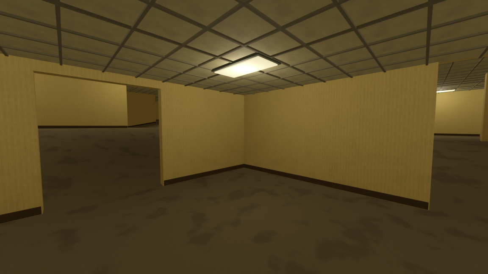
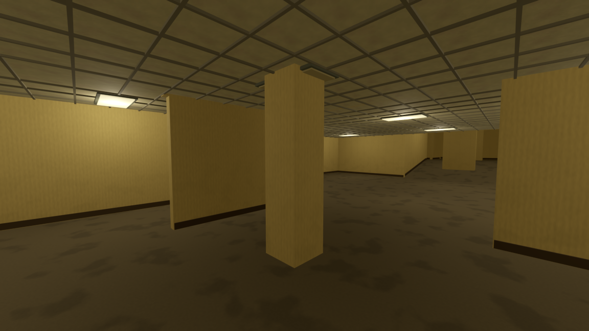
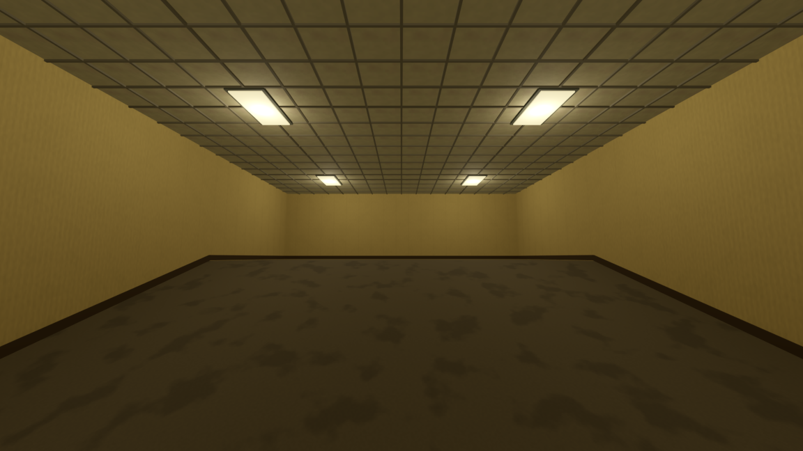
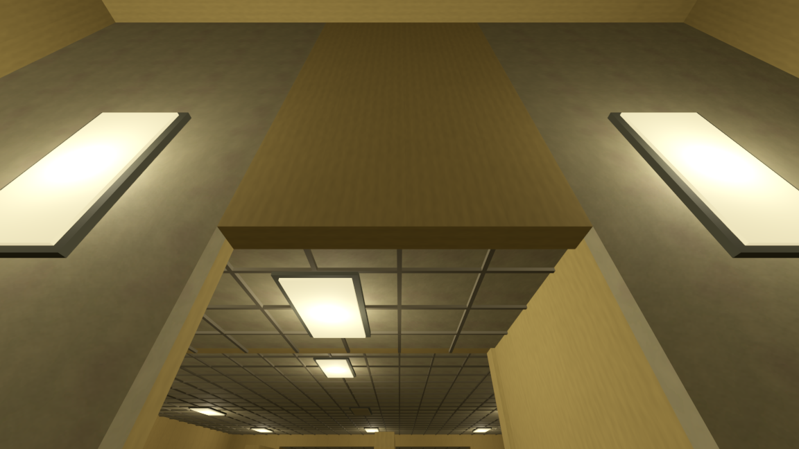
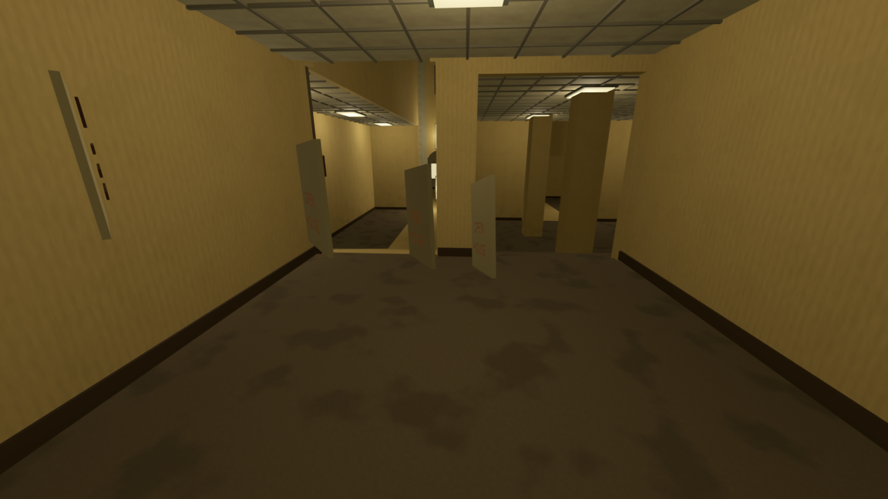

# TheRooms

Jeu d'exploration des Backrooms développé avec **Godot 4.7.2 / Forward+**. Le niveau 0 s'inspire de l'ambiance found footage de Kane Parsons : volumes liminaux, mobilier abandonné, lumière fluorescente et architecture progressivement incohérente.

## Aperçu du jeu

Captures réelles du framebuffer, sans retouche. Les deux premières ont été renouvelées le 2 octobre 2026 ; les autres proviennent des validations des pentes et anomalies du 1 octobre. Elles représentent des lieux de différentes graines, pas un parcours unique.

### Niveau 0 et espaces ouverts


### Colonnes et cloisons


### Verticalité par paliers et pentes


### Architecture tournée à 90°


### Échos spatiaux


## Fonctionnement

- Génération déterministe au fil de l'exploration ; les revisites retrouvent leur décor.
- Géométrie préparée à 38 m, chargée à 30 m et déchargée au-delà de 46 m. Les passages vers une salle non chargée restent fermés.
- Biomes cohérents avec transitions progressives, mobilier dispersé et ouvertures rectangulaires, larges ou en arche.
- Paliers et rampes, avec une altitude bornée. Les véritables escaliers entre espaces surélevés restent à implémenter.
- Chaos croissant : salles à 90°, cloisons incomplètes, objets encastrés et échos d'objets.
- Pas amortis sur moquette, ambiance localisée, absence de sprint.
- Géométrie regroupée par matériau, lumières limitées en distance et absence d'ombres dynamiques.

## Lancer le projet

Ouvrir `project.godot` dans **Godot 4.7.2**, puis lancer la scène principale avec **F6 depuis `scenes/main.tscn`**, ou le projet avec **F5**. Le rendu utilise Forward+ ; une carte compatible Vulkan est nécessaire.

Les déplacements suivent les actions configurées dans `project.godot` : `move_left`, `move_right`, `move_forward`, `move_back`, `jump` et `pause`. La souris contrôle le regard. Le bridge MCP local est facultatif et reste inactif sans sa configuration de port.

## Vérification

Depuis la racine du dépôt, remplacer `godot` par le chemin de l'exécutable local si nécessaire :

```powershell
godot --headless --path . --editor --quit
godot --headless --path . --script res://tests/streaming_validation.gd
godot --path . --script res://tests/ramps_validation.gd
godot --path . --script res://tests/streaming_walk.gd -- --deep
```

Les tests couvrent plusieurs graines, les ouvertures, la fermeture vers le vide, la pause, l'audio et le parcours avec collisions. Les scripts de captures sont des outils locaux ; certains chemins de sortie restent spécifiques au poste de développement.

## Organisation

| Dossier | Contenu |
| --- | --- |
| `scenes/` | Scène principale et joueur |
| `scripts/` | Génération, profils, contrôleur, audio et ambiance |
| `shaders/` | Papier peint et moquette |
| `textures/` | Textures utilisées par le jeu |
| `tests/` | Validation et captures |
| `addons/godot_mcp/` | Bridge local de développement |
| `docs/screenshots/` | Captures intégrées à ce README |

La [direction artistique](DIRECTION_ARTISTIQUE.md) conserve les choix de conception. Les rapports datés à la racine documentent les passes successives et peuvent décrire des décisions ensuite remplacées, notamment les marches supprimées des pentes.

Les anciennes scènes et assets inutilisés ont été archivés localement hors du dépôt. Les caches Godot, réglages personnels, sauvegardes et logs ne sont pas versionnés.
